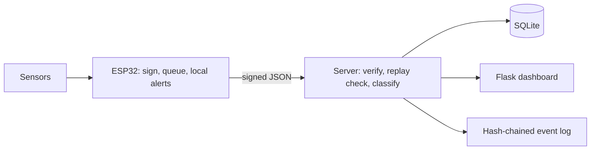

# MedGuard AI

[](https://github.com/YOUR-USERNAME/medguard-ai/actions)


A low-cost, secure patient-monitoring prototype that checks not only the patient's readings but also **whether the data can be trusted**.

> **Not a medical device.** MedGuard AI is a research and hackathon prototype. Consumer-grade sensors and the alert logic here have not been clinically validated and must not be used for patient-care decisions.

## The problem
Connected patient-monitoring systems can suffer from inaccurate sensor readings, false alarms, data tampering and internet failures, which can delay the identification of important changes in a patient's condition.

## What it does
- **Real-time monitoring** of heart rate, SpO2 and temperature on a live dashboard.
- **Secure data verification:** HMAC-SHA256 message authentication with replay detection, so modified, unauthorised or repeated messages are rejected and logged.
- **Event classification:** separates possible health concerns from sensor faults, security incidents and network failures.
- **Anomaly detection:** an optional Isolation Forest flags unusual patterns for review.
- **Offline monitoring:** local alerts on the device, with readings queued and synchronised after reconnection.
- **Tamper-evident audit log:** each security event hashes the previous one.

**Safety rule:** an uncertain reading never suppresses a possible health alert. A suspect and abnormal reading is reported as `ALERT_LOW_CONFIDENCE`.

## Architecture

Details: [docs/architecture.md](docs/architecture.md) and [docs/threat-model.md](docs/threat-model.md).

## Quick start (no hardware needed)
```bash
git clone https://github.com/YOUR-USERNAME/medguard-ai.git
cd medguard-ai
python -m venv .venv && source .venv/bin/activate   # Windows: .venv\Scripts\activate
pip install -r requirements.txt

pytest -q                          # unit tests
python tests/tamper_demo.py        # attack demo: modified, replayed and buffered messages
python tests/bench_detection.py    # detection rate and processing time
```

### Run the server and dashboard
```bash
cp server/keys.example.json server/keys.json     # then set a long random key per device
python ml/train_isolation_forest.py              # optional: trains the demo anomaly model
python server/app.py --host 0.0.0.0              # open http://localhost:5000
```

### Flash the ESP32
1. Install the ESP32 board package in the Arduino IDE.
2. Copy `firmware/medguard_esp32/config.example.h` to `config.h` and set Wi-Fi, server URL, device ID and key (the key must match `server/keys.json`).
3. Keep `SIMULATE_SENSORS 1` to test the full secure pipeline with fake readings, then implement the real sensor reads marked `TODO`.

## Project status
| Component | Status |
|---|---|
| Message authentication, replay and freshness checks | Implemented and unit-tested |
| Event classification and safety rule | Implemented and unit-tested |
| Hash-chained audit log | Implemented and unit-tested |
| Flask dashboard and JSON API | Implemented |
| Isolation Forest | Demo trained on **synthetic** data only |
| ESP32 firmware: signing, sequence counter, queue, local alerts | Written, **not yet compiled or tested on hardware** |
| ESP32 sensor reads (MAX30102, DS18B20, MPU6050) | TODO |
| Persistent offline queue (LittleFS) | TODO |
| TLS transport | TODO (prototype uses HTTP) |

## Measured results (software simulation)
From `python tests/bench_detection.py` (server pipeline only; excludes real sensors, radio loss and network latency):

| Metric | Result |
|---|---|
| Genuine messages accepted | 1000 / 1000 |
| Tampered messages detected | 500 / 500 |
| Replayed messages detected | 500 / 500 |
| Median processing time | about 0.4 ms per message (machine dependent) |

Hardware and false-alert results are not yet measured. See [docs/evaluation-plan.md](docs/evaluation-plan.md).

## Repository layout
```
firmware/   ESP32 sketch (Arduino)
server/     Flask app, HMAC verification, classifier, SQLite storage
ml/         Isolation Forest training script (synthetic data)
tests/      Unit tests, attack demo, detection benchmark
docs/       Architecture, threat model, wiring, evaluation plan
```

## Limitations
- HMAC protects the message, not the physical sensor. A fooled sensor or a compromised device that holds the key can still send false data.
- Thresholds in `server/classifier.py` are illustrative, not clinical.
- The Isolation Forest has only been trained on synthetic data.
- Never commit real keys or Wi-Fi credentials. See [SECURITY.md](SECURITY.md).

## References
1. wolfSSL, ESP32 HMAC-SHA benchmarks: https://github.com/wolfSSL/wolfssl/blob/master/wolfcrypt/src/port/Espressif/README.md
2. Analog Devices, MAX30102: https://www.analog.com/en/products/max30102
3. University of Toronto, WristO2 (2021): https://www.cs.toronto.edu/~mgabel/papers/WristSense2021_WristO2%20-%20camera.pdf
4. SHM alarm systematic review: https://shmabstracts.org/?p=20427
5. CDSCO software guidance (NatLawReview): https://natlawreview.com/article/code-compliance-decoding-indias-medical-device-software-guidance

## Team
Add your team members and roles here.

## License
MIT. See [LICENSE](LICENSE).
